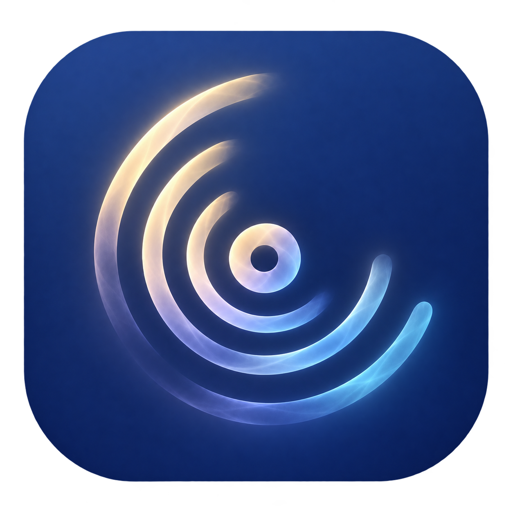

# 栖声 · Stillune

  

让声音停泊，让热爱长久。

## 软件理念

栖声 · Stillune 是一个面向 **Android** 的本地音乐播放器项目，致力于将高品质播放、声音分析、从容的聆听体验与听力关怀融为一体。让珍藏的音乐长久相伴，也让双耳适时休憩。

目前处于品牌设计与资源准备阶段，仓库尚未创建 Android 应用模块，也没有可安装 APK。原构想中的 Kotlin、Jetpack Compose、Media3 等均为安卓开发方向，尚未实现。

## 名称寓意

“栖”是停泊与休憩，“声”是音乐与陪伴，寓意让音乐有所栖，让聆听有归处。**Stillune** 是融合 **Still**（宁静）与 **Lune**（源自法语的月亮意象）的自造英文名，表达静夜与月色中的温柔陪伴。

## 图标设计

正式图标以深靛蓝铺开静夜，暖月白经淡紫向雾蓝柔和过渡。错落的半透明弧线围绕唱片轴心舒展，既像唱片沟槽与声音涟漪，也隐约勾勒出月牙。若隐若现的边缘与轻盈的空间感，呼应“栖声”的安静气质，以及对音乐品质与双耳健康的关照。

正式品牌展示版采用四角对称的圆角正方形，外围透明，让轮廓与月光般的轻盈质感相呼应。它用于 README、图册等展示，不能直接代替 Android 自适应启动图标。

图标文件：[圆角正式版](assets/branding/stillune-icon.png) · [未裁角方形源图](assets/branding/stillune-icon-source-square.png)。方形源图用于后续平台自适应图标制作。

## Android 图标资源

- [启动图标资源包](assets/android/res/)：包含前景、满幅背景、Android 8.0+ 自适应图标、Android 13+ 单色主题图标及旧版多密度资源。外形由设备桌面裁切，不预先固定圆角。
- [Google Play 图标](assets/android/play-store-512.png)：512×512、不透明、未裁角的 PNG，供商店上传；与启动图标分别准备。
- [平台适配说明](docs/android-icon-integration.md)：资源用途、接入方式、检查结果与尚未完成的工作。

圆角展示偏好继续保留；不同安卓桌面可显示圆形、圆角方形等轮廓。此前采用的 30% 圆角比例来自 Google Play 展示规范，并非安卓启动图标的统一形状要求。
